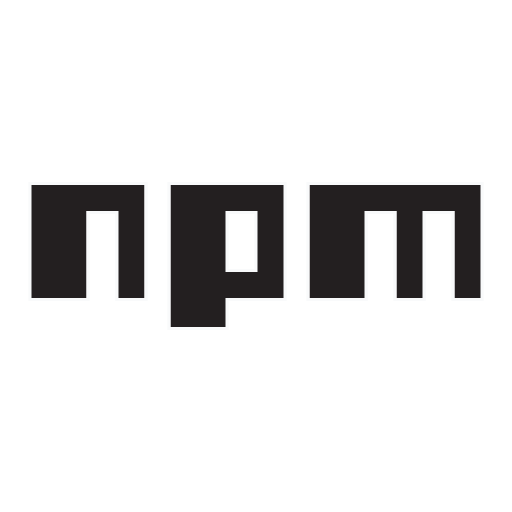

##### Abusing npm Registry for C2

Commands are encoded as npm dist-tag names on a controlled package. The
implant polls the public registry API, reads tags matching a known prefix,
executes the decoded command, and optionally writes results back as new
tags. No authentication is needed to read tags.



#### How It Works

npm dist-tags are key-value pairs attached to published packages. They
normally map human-readable names to version strings. The registry allows
arbitrary tag names up to 250 characters. The operator creates tags that
look like CI build artifacts. All data is in the tag name.

Tag naming convention:

    <prefix><nonce>_<base64url(payload)>

Prefixes distinguish tag types:

| prefix | meaning | who writes |
|--------|---------|------------|
| x64- | command | operator |
| arm64- | result | implant |
| ia32- | heartbeat | implant |

The value is always "1.0.0". The value carries no data. The tag name is
the data carrier.

Communication flow:

    operator:  PUT /-/package/<name>/dist-tags/x64-<nonce>_<b64cmd>
    implant:   GET  /-/package/<name>/dist-tags  (no auth)
    implant:   decode x64-* tags, execute commands
    implant:   PUT /-/package/<name>/dist-tags/arm64-<nonce>_<b64out>
    implant:   PUT /-/package/<name>/dist-tags/ia32-<nonce>
    operator:  GET  /-/package/<name>/dist-tags
    operator:  decode arm64-* tags, read output

The implant polls every N seconds with jitter. Every 10 cycles it sends
a heartbeat tag to signal liveness.

#### Why It Is Hard To Detect

1. Traffic goes to registry.npmjs.org, whitelisted by most proxies.
2. Reads are GETs to a Cloudflare-cached endpoint, identical to npm
   outdated, npm view, or Dependabot.
3. No credentials needed for reading. The implant never stores secrets
   on the read path.
4. dist-tags are invisible in the npm web UI. Only the API shows them.
5. Tag names look like platform build artifacts (x64-a3f2c8). They do
   not stand out in registry logs.
6. The published package is empty. No malicious code is ever published.

#### Key Detection Opportunities

1. Non-Node.js process making periodic GETs to registry.npmjs.org.
2. Statistical polling pattern with jitter.
3. User-Agent mismatch (Python-urllib vs npm CLI UA).
4. TLS JA3 fingerprint differs from Node.js (Schannel on Windows).
5. python.exe or non-Node binary making npm registry calls.
6. npm token in non-Node.js context.
7. Package with one version but hundreds of rapidly changing tags.

#### API Detection

```
GET Requests to:
https://registry.npmjs.org/-/package/*/dist-tags

PUT Requests to:
https://registry.npmjs.org/-/package/*/dist-tags/*

DELETE Requests to:
https://registry.npmjs.org/-/package/*/dist-tags/*
```

#### References

- npm dist-tags API: https://github.com/npm/registry/blob/master/docs/SPEC.md
- npm granular access tokens: https://docs.npmjs.com/creating-and-viewing-access-tokens
- npm-c2: https://github.com/ikarus981/npm-c2
